# دليل الاستخدام والعرض الشامل — حارس العلامة | Brand Guard User & Presentation Manual

> **ملاحظة:** يمكنك فتح النسخة التفاعلية المصممة للعرض والطباعة كـ PDF عبر الملف **[`client-manual.html`](./client-manual.html)**.
>
> **نطاق صادق:** التطبيق يعمل محلياً أولاً. ميزات Supabase متعددة المستأجرين، كاشف النطاقات السحابي، عامل التقاط الأدلة، مؤقتات SLA السحابية، والمسارات الإنتاجية الأخرى موصوفة أدناه كخيارات تحتاج نشر/تحقق، وليست ادعاءات تشغيل إنتاجي مؤكدة. لا يرسل التطبيق بلاغات إلى المنصات تلقائياً؛ الإرسال دائماً يدوي من المالك/المفوّض.

---

# القسم الأول: الدليل الشامل باللغة العربية (Arabic Manual)

## ١. ما هو تطبيق «حارس العلامة»؟
**حارس العلامة (Brand Guard)** هو غرفة عمليات لحماية علامتك التجارية من الحسابات الوهمية، المواقع المنتحلة، أرقام الواتساب المحتالة، والإعلانات المضللة.
- **الرصد المبكر:** تسجيل ورصد الحسابات والمواقع والإعلانات المشبوهة قبل أن تخدع العملاء.
- **تحذير العملاء فوراً:** توليد صورة تحذير للستوري (`1080×1920`) بضغطة زر.
- **تجهيز بلاغ سريع:** كتابة نص البلاغ وفتح نموذج المنصة المباشر؛ الإرسال يتم يدوياً.
- **تصعيد منظم:** كشف بيانات مسجّل النطاق (`RDAP`) وتجهيز ملف PDF للجهات الرسمية.

---

## ٢. الشاشة الرئيسية ولوحة التحكم بالحالات (Cases Dashboard)

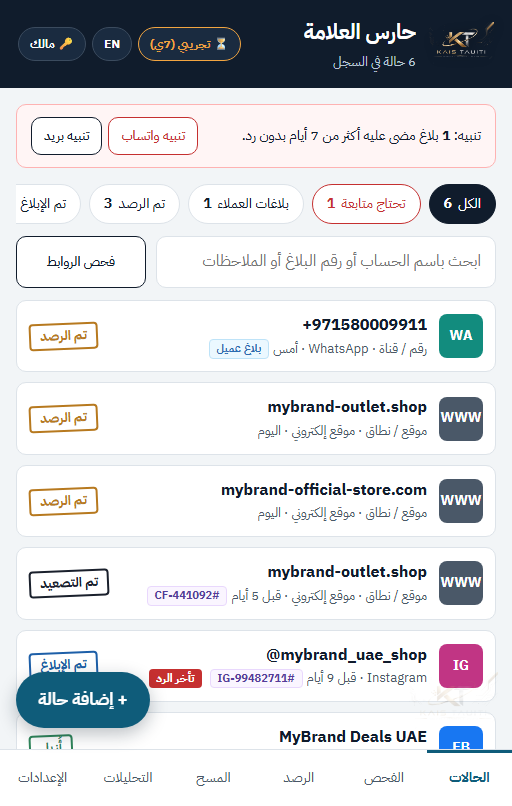

- **زر `🔑 مالك / 👤 موظف`:** يبدّل بين وضع المالك ووضع الموظف المحلي. وضع الموظف يمنع حذف الحالات أو تعديل الإعدادات.
- **زر `EN / عربي`:** يقلب واجهة التطبيق فوراً بين العربية والإنجليزية.
- **شريط تنبيه البلاغات المتأخرة:** يظهر عند تجاوز مدة المتابعة المحددة، مع زرّي **«تنبيه واتساب»** و**«تنبيه بريد»**.
- **أزرار التصفية والبحث وفحص الروابط:** فلترة حسب الحالة/بلاغات العملاء، بحث بالاسم أو رقم البلاغ، وفحص روابط الحالات.
- **الزر العائم `+ إضافة حالة`:** لتسجيل حالة جديدة.

---

## ٣. النسخة الإنجليزية والتبديل الثنائي الفوري (Bilingual Arabic / English)

- افتح `index.html` أو `hares-alalama.html` للواجهة العربية، أو `brand-guard-en.html` للواجهة الإنجليزية المباشرة.
- كلا الواجهتين تتشاركان نفس قاعدة البيانات المحلية في نفس المتصفح/الأصل.

---

## ٤. إضافة حالة انتحال جديدة + ختم توثيق الأدلة (Add Case & Documented Evidence Stamp)

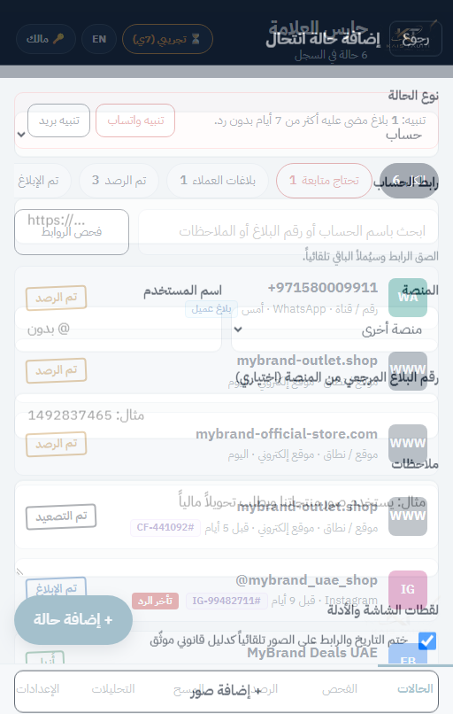

1. **نوع الحالة:** حساب، موقع/نطاق، رقم/قناة، إعلان مدفوع، إعلان في متجر.
2. **لصق الرابط:** يتعرّف التطبيق على المنصة ويستخرج اسم المستخدم أو النطاق.
3. **رقم البلاغ المرجعي:** لحفظ رقم الشكوى الصادر من المنصة.
4. **ختم توثيق الأدلة:** يضغط الصورة ويطبع شريطاً مساعداً يحتوي على وقت الجهاز بصيغة UTC والرابط والعلامة. هذا الشريط يساعد على التنظيم، لكنه ليس إثباتاً قانونياً مستقلاً أو ختم خادم.

---

## ٥. تفاصيل الحالة: فحص الرابط وكاشف بيانات مسجّل الموقع (Whois / RDAP)

- **فحص حالة الرابط:** يتحقق مما إذا كان الرابط ما زال يعمل أم توقف.
- **فحص Whois / RDAP:** يكشف مسجّل النطاق، تاريخ التسجيل، خوادم الأسماء، وبريد الإبلاغ عن الانتهاكات إن توفّر.
- **إرسال بلاغ إيقاف لمسجّل النطاق:** يفتح رسالة بريد جاهزة؛ الإرسال يتم من برنامج البريد لديك.

---

## ٦. مولّد بطاقة تحذير العملاء للستوري (1-Click Scam Alert Story Card)

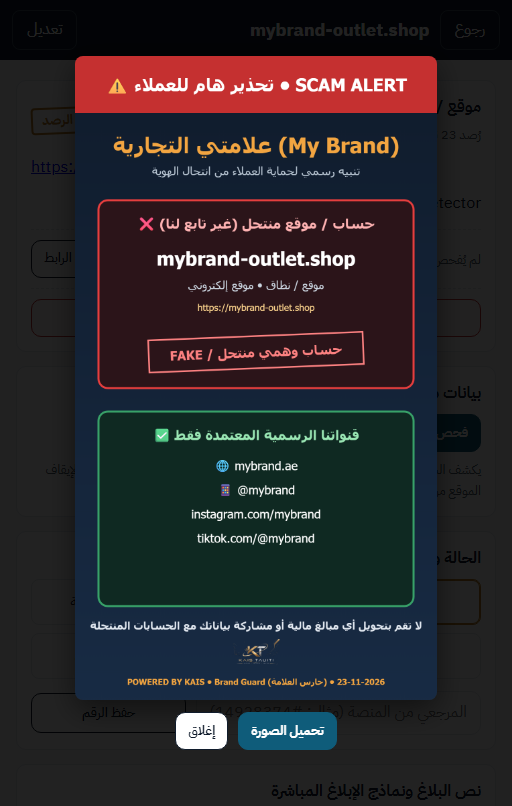

- بالضغط على **«إنشاء بطاقة تحذير للعملاء»**، يصمّم التطبيق صورة `1080×1920 PNG` تعرض الحساب/الموقع المشبوه في صندوق أحمر وقنواتك الرسمية في صندوق أخضر، جاهزة للتحميل والنشر اليدوي.

---

## ٧. نص البلاغ والنماذج الرسمية المباشرة (Takedown Report & Direct Forms)

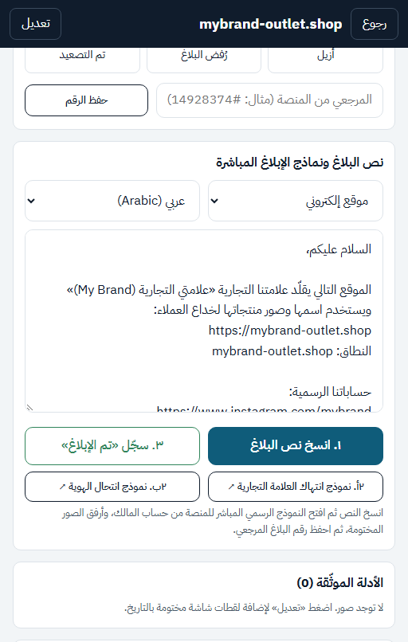

- **أزرار مراحل الحالة:** تم الرصد، تم الإبلاغ، قيد المراجعة، أُزيل، رُفض البلاغ، تم التصعيد.
- **مولّد نص البلاغ (عربي / English):** يكتب خطاب شكوى يتضمن بيانات العلامة والروابط الرسمية ورقم البلاغ إن وجد.
- **خطوات الإبلاغ:** انسخ النص، افتح النموذج الرسمي المباشر، أرفق الأدلة، ثم سجّل «تم الإبلاغ» ورقم البلاغ المرجعي. لا يوجد إرسال تلقائي.

---

## ٨. مركز التصعيد للجهات الرسمية (الإمارات • السعودية • عالمي)

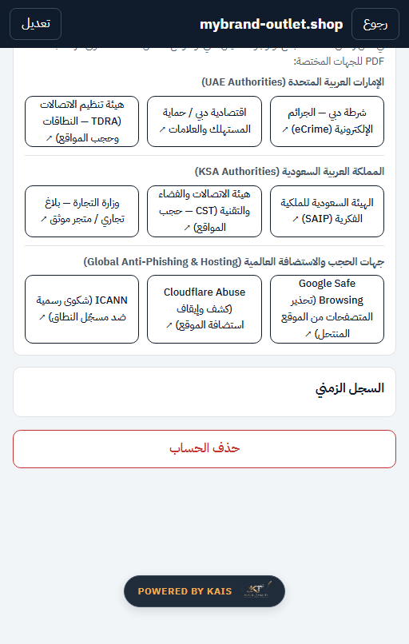

- **طباعة ملف الحالة PDF:** يجهّز ملف شكوى منظماً لهذه الحالة.
- **الإمارات:** شرطة دبي (`eCrime.ae`)، اقتصادية دبي، TDRA.
- **السعودية:** SAIP، CST، وزارة التجارة.
- **عالمي:** Google Safe Browsing، Cloudflare Abuse، ICANN Compliance.

---

## ٩. تبويب «الفحص الاستباقي» (Proactive Scan Tab)

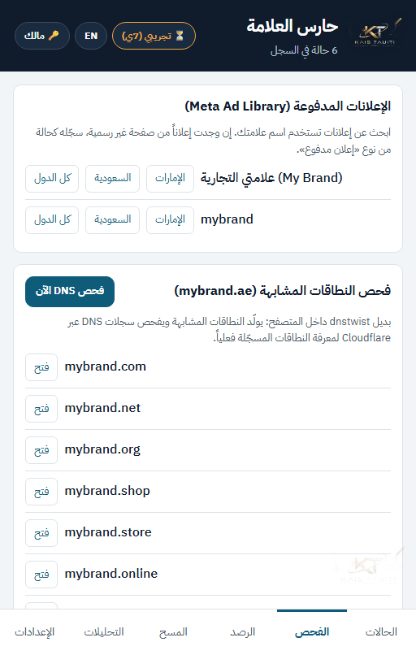

- **Meta Ad Library:** روابط بحث عن إعلانات تستخدم اسم علامتك في الإمارات/السعودية/كل الدول.
- **فحص النطاقات المشابهة:** يولّد نطاقات مشابهة ويفحص DNS عبر Cloudflare، مع زر تسجيل كحالة للنطاقات المسجّلة.
- **فحص صور المنتجات:** روابط Google Lens وTinEye للبحث العكسي.
- **بحث جوجل السريع وتنويعات اسم الحساب:** قائمة تنويعات مع مربعات تدقيق.

---

## ١٠. الإعدادات (الجزء الأول): بيانات العلامة، العرض التجريبي، ونموذج العملاء

- **بيانات العلامة التجارية:** تُحفظ مرة واحدة وتُستخدم في البلاغات والبطاقات والفحوصات.
- **عرض تجريبي للعملاء:** يملأ بيانات علامة محايدة و٤ حالات نموذجية للعرض أو التدريب.
- **نموذج بلاغات العملاء (`?report=1`):** رابط عام يتيح للعملاء الإبلاغ دون رؤية بياناتك الداخلية.

---

## ١١. الإعدادات (الجزء الثاني): التنبيهات، الصلاحيات، السحابة، وملف الشكوى

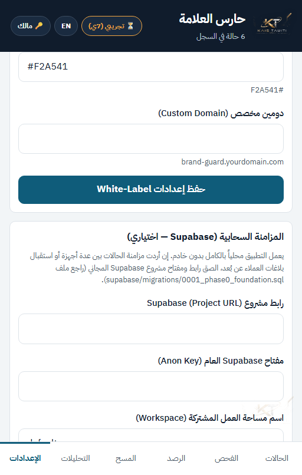
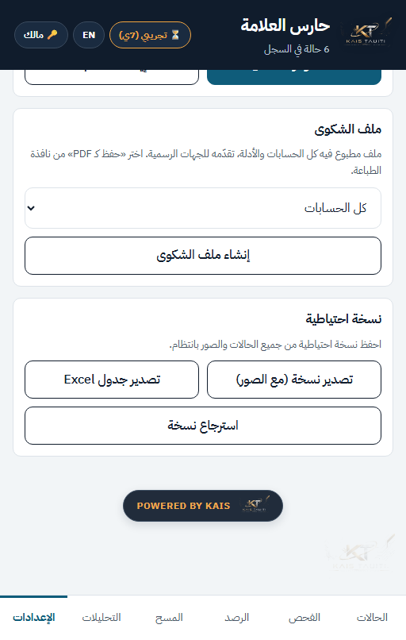

- **تنبيهات التأخير:** واتساب/بريد/إشعارات متصفح بمساعدة الجهاز، وليست خدمة إشعارات خادم مؤكدة.
- **وضع الموظف وPIN:** قفل راحة محلي؛ ليس حد أمان سحابي.
- **المزامنة السحابية الاختيارية:** تعمل حالياً عبر جداول `hares_cases`/`hares_settings` القديمة. مسار الجداول متعدد المستأجرين الجديد يحتاج نشر migrations والتحقق الحي.
- **ملف الشكوى والنسخ الاحتياطي:** PDF قابل للطباعة، CSV، وJSON كامل مع الصور.

---

## ١٢. نموذج استقبال بلاغات العملاء العام (Public Customer Report Form)

- يرى العميل نموذجاً مبسطاً باسم علامتك فقط، دون قائمة الحالات أو الإعدادات.
- يرفق رابطاً/رقماً وتفاصيل ولقطة شاشة اختيارية. تُختم الصورة بوقت الجهاز بصيغة UTC للتوثيق، وليس كختم خادم قانوني مستقل.
- يظهر البلاغ في لوحتك بوسم **بلاغ عميل** للمراجعة البشرية.

---

## ١٣. تبويب «الرصد» (Suspected Inbox)

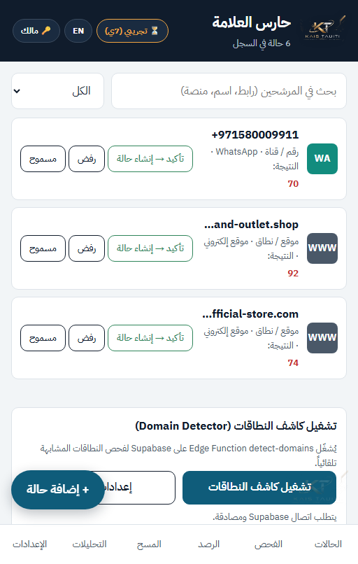

- يعرض حالياً السجلات المحلية ذات المصدر `customer` أو `detect-domains` أو `detect-ct`، وليس جدول `candidates` السحابي بعد.
- بحث وتصفية حسب: الكل، جديد، مؤكد، مرفوض، مسموح.
- **تأكيد:** يحدّث السجل المحلي إلى حالة مرصودة؛ لا ينشئ سجلاً سحابياً منفصلاً بعد.
- **رفض/مسموح:** تحديثات مراجعة محلية. قائمة السماح الدائمة للعلامة تُدار من الإعدادات.
- **تشغيل كاشف النطاقات:** يتطلب Supabase ومصادقة ومساحة عمل/علامة ونشر Edge Function `detect-domains`. لم يتم التحقق الحي بعد.

---

## ١٤. تبويب «المسح» (Sweep) وصفحة التحقق العامة

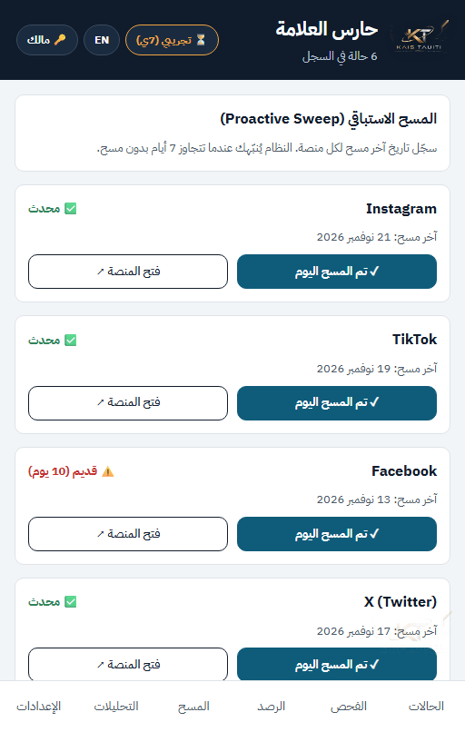
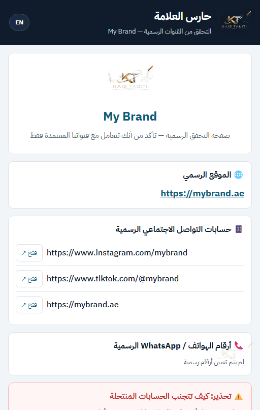

- يسجّل آخر مسح لكل منصة ويحذّر بعد 7 أيام أو أكثر بدون مسح.
- عرض ميزانية SERP الحالي توضيحي/ثابت، وليس تكاملاً حياً.
- فاحص الأرقام يقارن الرقم المدخل برقم الهاتف/واتساب في الإعدادات؛ التطبيع الكامل E.164 جزئي.
- صفحة `?verify=1` تعرض القنوات الرسمية وتحذيراً للعملاء، مع نسخ الرابط أو المعاينة.

---

## ١٥. تبويب «التحليلات» (Analytics)

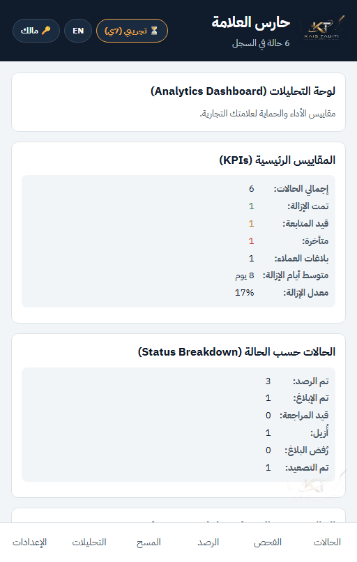

- مؤشرات: إجمالي الحالات، تمت الإزالة، قيد المتابعة، المتأخرة، بلاغات العملاء، متوسط أيام الإزالة، معدل الإزالة.
- توزيعات حسب الحالة والنوع والمنصة.
- طباعة تقرير PDF أو تصدير CSV. حدود الخطة معروضة توضيحياً؛ الفوترة والإنفاذ الكامل ليسا مسار إنتاج مؤكد بعد.

---

## ١٦. الإعدادات المتقدمة: Onboarding، White-Label، المصادقة، الصحة، الأدلة وSLA

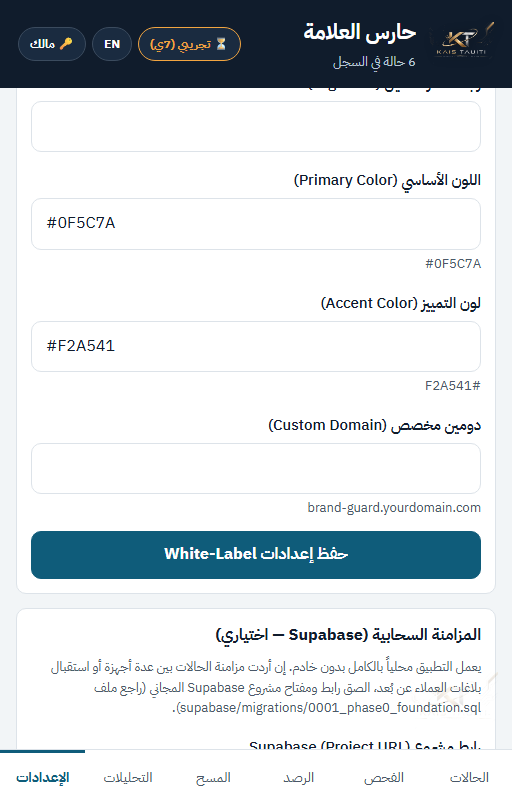
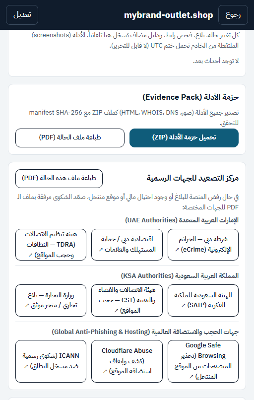

- **Onboarding Checklist:** بيانات العلامة، القنوات الرسمية، صور المنتجات، Supabase الاختياري، رقم تسجيل العلامة.
- **White-Label:** شعار وألوان ودومين مخصص محلياً؛ الدومين لا يُجهّز تلقائياً.
- **المصادقة ومساحات العمل:** تظهر عند إعداد Supabase. سياسات RLS موجودة في migrations، لكن النشر والاختبار الحي لم يكتملا.
- **حالة النظام `?health=1`:** صفحة حالة واجهة، وليست مراقبة إنتاجية عميقة.
- **الجدول الزمني وطلب التقاط الأدلة:** أحداث محلية. طلب الالتقاط يرسل إلى `capture_jobs` فقط في المسار السحابي المصادق؛ الوضع المحلي يجهّز الطلب دون التقاط فعلي. عامل Playwright غير منشأ/مُتحقق إنتاجياً.
- **حزمة الأدلة:** الزر موسوم ZIP، لكن التنفيذ الحالي ينزّل JSON manifest وليس ZIP فعلياً، وقيم SHA-256 عناصر نائبة/مقتطعة وليست hashes محسوبة.
- **SLA:** مؤقتات تُنشأ عند «تم الإبلاغ» فقط في المسار السحابي المصادق؛ لا يوجد إعادة فتح تلقائي مؤكد في الواجهة الحالية.
- **التنبيهات:** رموز Telegram/البريد تُحفظ في المتصفح؛ لا تعاملها كإعداد إنتاجي آمن قبل نقل الأسرار إلى خادم/Edge Function.

---
---

# Part 2: Complete English User & Presentation Manual

> **Honest scope:** Brand Guard is local-first. Supabase multi-tenant features, the cloud domain detector, evidence capture worker, cloud SLA timers, and other production paths are described below as options requiring deployment/verification, not as verified production claims. The app never auto-submits platform reports; a human always submits.

## 1. Main Cases Dashboard & Control Room

- **Owner / Staff role pill:** local role switch; Staff cannot delete cases or edit settings.
- **EN / عربي language pill:** instant Arabic RTL / English LTR switching.
- **Overdue alert banner:** WhatsApp/email summary buttons for overdue reports.
- **Filters, search, and Check Links:** filter by status/customer reports, search by handle or reference ID, and batch-check links.

## 2. Instant Arabic / English Language Switcher
- Open `index.html` or `hares-alalama.html` for Arabic, or `brand-guard-en.html` for English.
- Both share the same local browser database for the same origin.

## 3. Adding a Case & Documented Evidence Stamp

- Five case types: account, website/domain, phone/channel, paid ad, store listing.
- Smart URL paste auto-detects platform and handle/domain.
- Reference ID field stores the platform ticket number.
- The evidence stamp compresses screenshots and adds a documentation bar with device time formatted as UTC, target, and brand. It is not an independent legal server timestamp or standalone legal proof.

## 4. Case Detail: Link Checker & Whois / RDAP Inspector

- **Check Link Status:** probes whether the link is still live.
- **Lookup Whois / RDAP:** reveals registrar, registration date, nameservers, and abuse email when available.
- **Email registrar abuse:** opens a prepared email in your mail client; sending remains manual.

## 5. Customer Scam Alert Story Card

- Generates a `1080×1920 PNG` warning card showing the suspected account/domain in red and official channels in green, ready for manual download and posting.

## 6. Legal Takedown Text & Direct Platform Forms

- Status steps: Detected, Reported, In Review, Removed, Rejected, Escalated.
- Arabic/English report generator includes brand credentials, official URLs, and reference ID when present.
- Copy the text, open the official platform form, attach evidence, then mark Reported and save the reference ID. No automatic submission.

## 7. Official Escalation Center (UAE • KSA • Global)

- Printable single-case PDF dossier.
- UAE: Dubai Police eCrime, Dubai Economy, TDRA.
- KSA: SAIP, CST, Ministry of Commerce.
- Global: Google Safe Browsing, Cloudflare Abuse, ICANN Compliance.

## 8. Proactive Scan Tab

- Meta Ad Library search links for UAE/KSA/All.
- Cloudflare DNS lookalike domain scanner with add-case action for registered domains.
- Google Lens / TinEye reverse image search links.
- Quick Google site search and handle-variation checklist.

## 9. Settings (Part 1): Brand Profile, Demo Preset & Customer Link

- Brand profile feeds reports, scans, and warning cards.
- Client Demo Preset loads neutral sample data and four sample cases.
- Public Customer Report Link (`?report=1`) lets customers submit reports without seeing internal cases.

## 10. Settings (Part 2): Alerts, Roles & PIN, Cloud Sync, Dossier & Backup

- Overdue alerts via WhatsApp/email/browser notifications are device-assisted, not a verified server notification service.
- Local Owner PIN / Staff Mode is a convenience lock, not a cloud security boundary.
- Optional Supabase sync currently uses legacy `hares_cases`/`hares_settings` tables. New multi-tenant migrations need deployment and live verification.
- Printable PDF dossier, CSV export, and full JSON backup/restore.

## 11. Public Customer Report Form (?report=1)

- Customers see only a branded public form, not your case list or settings.
- Optional screenshots are stamped with a UTC-formatted device timestamp for documentation, not an independent legal server timestamp.
- Submissions appear in your dashboard with a Customer Report badge for human review.

## 12. "Suspected" Tab (Inbox)
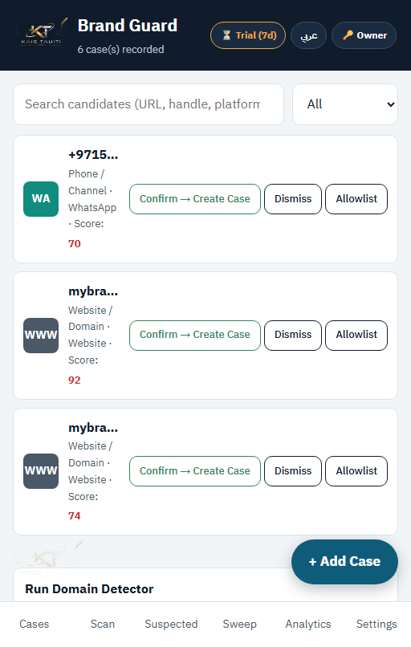

- Currently shows local records sourced from `customer`, `detect-domains`, or `detect-ct`, not the cloud `candidates` table yet.
- Search and filter by All/New/Confirmed/Dismissed/Allowlisted.
- Confirm updates the local record to a detected case; it does not yet create a separate cloud case.
- Dismiss/Allowlist are local review updates. The permanent brand allowlist is managed in Settings.
- Run Domain Detector requires Supabase, authentication, active workspace/brand, and a deployed `detect-domains` Edge Function. Not live-verified yet.

## 13. "Sweep" Tab & Public Verify Page
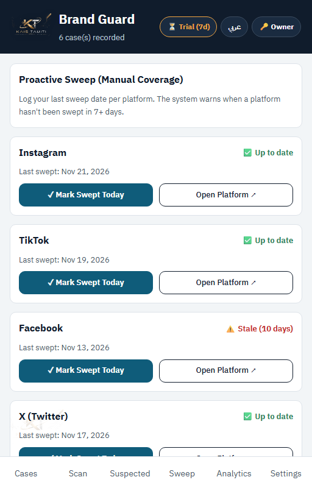

- Tracks last sweep date per platform and warns after 7+ days.
- SERP budget display is illustrative/static, not a live provider integration.
- Phone mismatch checker compares against the configured phone/WhatsApp number; full E.164 normalization is partial.
- `?verify=1` shows official channels and a customer warning, with copy/preview actions.

## 14. "Analytics" Tab
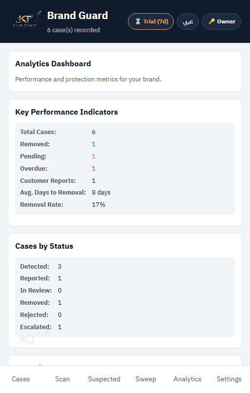

- KPIs: total, removed, pending, overdue, customer reports, average days to removal, removal rate.
- Breakdowns by status, type, and platform.
- Print PDF report or export CSV. Plan limits are illustrative; billing and full enforcement are not yet verified production paths.

## 15. Advanced Settings: White-Label, Onboarding, Auth, Health, Evidence & SLA
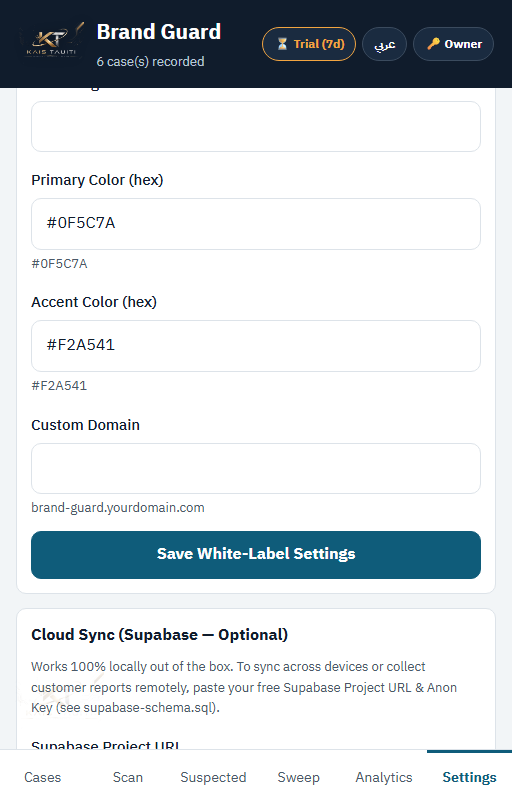
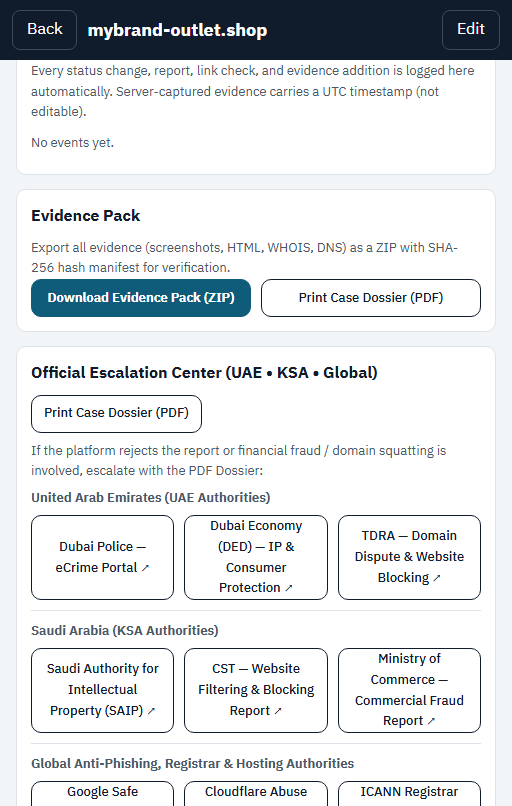

- **Onboarding checklist:** brand profile, official channels, product images, optional Supabase, trademark number.
- **White-Label:** local logo/colors/custom domain; custom domain is not auto-provisioned.
- **Auth/workspaces:** appear when Supabase is configured. RLS policies exist in migrations, but deployment/live testing are incomplete.
- **Health `?health=1`:** UI status page, not deep production monitoring.
- **Timeline/capture:** local case events. Capture requests post to `capture_jobs` only in the authenticated cloud path; local mode prepares a request without actual capture. The Playwright worker is not deployed/live-verified.
- **Evidence Pack:** button says ZIP, but current implementation downloads a JSON manifest, not a real ZIP, with placeholder/truncated SHA-256 entries rather than computed hashes.
- **SLA:** timers are created on Reported only in the authenticated cloud path; no verified automatic reopen exists in the current UI.
- **Alerts:** Telegram/email credentials are browser-stored; do not treat them as production-secure until secrets move to a server/Edge Function.
