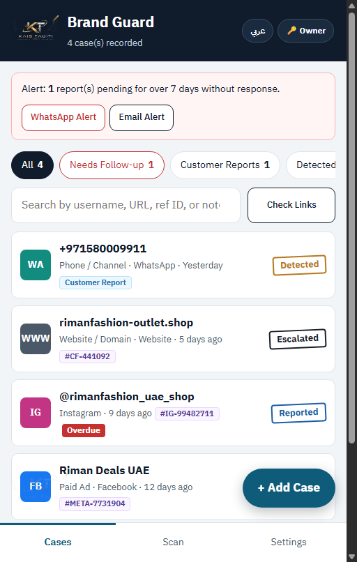
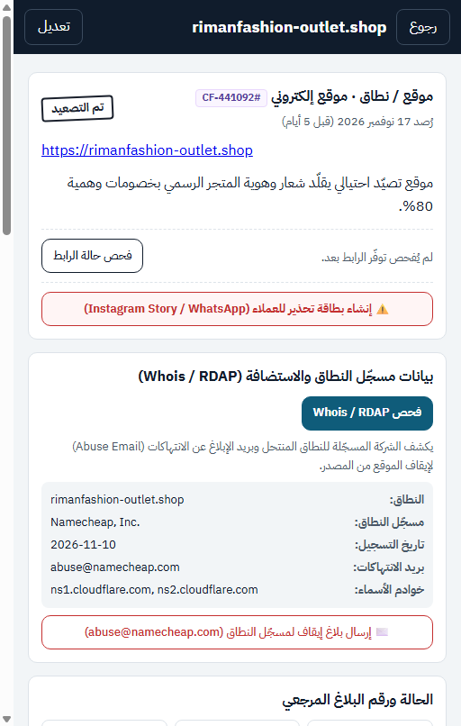
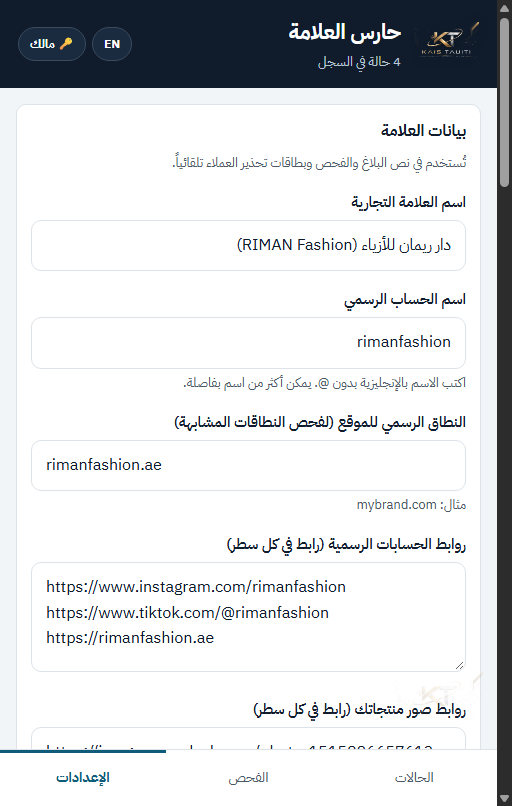
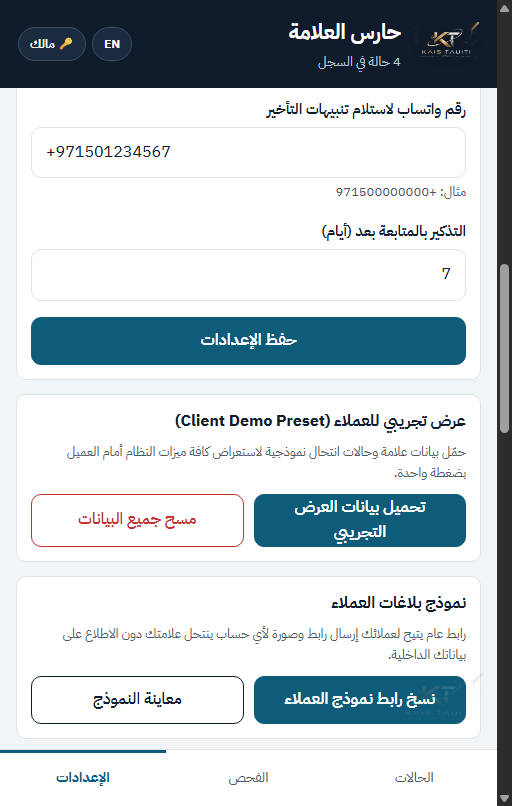
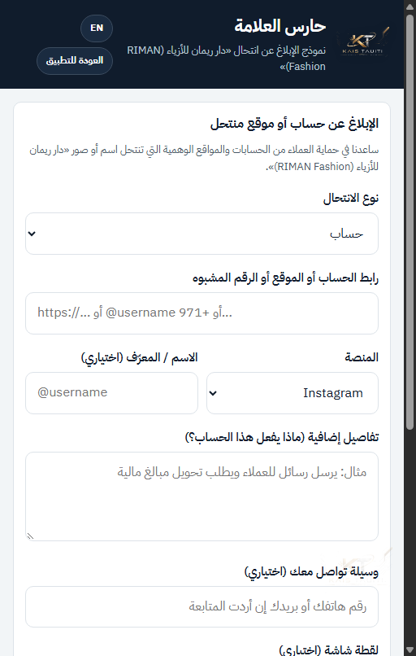

# دليل الاستخدام والعرض الشامل — حارس العلامة | Brand Guard User & Presentation Manual

> **ملاحظة:** يمكنك فتح النسخة التفاعلية المصممة للعرض والطباعة كـ PDF عبر الملف **[`client-manual.html`](./client-manual.html)**.

---

# القسم الأول: الدليل الشامل باللغة العربية (Arabic Manual)

## ١. ما هو تطبيق «حارس العلامة»؟
**حارس العلامة (Brand Guard)** هو غرفة عمليات متكاملة لحماية علامتك التجارية من الحسابات الوهمية، المواقع المنتحلة، أرقام الواتساب المحتالة، والإعلانات المضللة.
- **الرصد المبكر:** اكتشاف الحسابات والمواقع والإعلانات المنتحلة قبل أن تخدع العملاء.
- **تحذير العملاء فوراً:** توليد صورة تحذير رسمية للستوري (`1080×1920`) بضغطة زر.
- **إغلاق قانوني سريع:** كتابة نص البلاغ القانوني تلقائياً مع ختم الصور بالتاريخ وفتح نموذج المنصة المباشر.
- **تصعيد رسمي موثّق:** كشف مستضيف الموقع المنتحل (`Whois / RDAP`) وتصعيد بملف PDF لشرطة دبي، TDRA، وSAIP.

---

## ٢. الشاشة الرئيسية ولوحة التحكم بالحالات (Cases Dashboard)

- **زر `🔑 مالك / 👤 موظف` (أعلى اليسار):** يبدّل بين وضع المالك (كامل الصلاحيات) ووضع الموظف (يسمح بإضافة ومتابعة الحالات ويمنع حذف الحالات أو تعديل الإعدادات).
- **زر `EN / عربي`:** يقلب واجهة التطبيق بالكامل فوراً بين العربية والإنجليزية.
- **شريط تنبيه البلاغات المتأخرة (الأحمر):** يظهر تلقائياً عند مرور أكثر من ٧ أيام على البلاغ بدون رد من المنصة، مع زرّي **«تنبيه واتساب»** و**«تنبيه بريد»** لإرسال ملخص فوري.
- **أزرار التصفية (`الكل` • `تحتاج متابعة` • `بلاغات العملاء` • الحالات):** لفلترة القائمة بضغطة واحدة.
- **مربع البحث + زر `فحص الروابط`:** للبحث الفوري بالاسم أو رقم البلاغ (`#IG-...`)، وفحص جميع روابط الحالات دفعة واحدة للتأكد مما إذا أُغلقت أم ما زالت نشطة.
- **الزر العائم `+ إضافة حالة`:** لتسجيل أي حساب أو موقع أو رقم منتحل جديد.

---

## ٣. النسخة الإنجليزية والتبديل الثنائي الفوري (Bilingual Arabic / English)

- افتح `index.html` أو `hares-alalama.html` للواجهة العربية، أو `brand-guard-en.html` للواجهة الإنجليزية المباشرة.
- كلا الواجهتين تتشاركان نفس قاعدة البيانات والحالات المحفوظة.

---

## ٤. إضافة حالة انتحال جديدة + ختم الأدلة القانوني (Add Case & Forensic Stamp)

1. **نوع الحالة:** اختر من ٥ أنواع (`حساب`، `موقع / نطاق`، `رقم / قناة`، `إعلان مدفوع`، `إعلان في متجر`).
2. **لصق الرابط (Auto-Detect):** بمجرد لصق الرابط، يتعرّف التطبيق تلقائياً على المنصة ويستخرج اسم المستخدم أو النطاق.
3. **رقم البلاغ المرجعي (`Reference ID`):** لحفظ رقم الشكوى الصادر من المنصة (مثال: `IG-8841209`).
4. **ختم التاريخ والرابط على الصور كدليل قانوني (Forensic Stamp):** يطبع تلقائياً شريط توثيق قانوني أسفل كل لقطة شاشة يحتوي على التاريخ والوقت العالمي `UTC` والرابط المنتحل واسم العلامة.

---

## ٥. تفاصيل الحالة: فحص الرابط وكاشف بيانات مسجّل الموقع (Whois / RDAP)

- **زر `فحص حالة الرابط`:** يتحقق مما إذا كان الموقع المنتحل ما زال يعمل أم توقف (`NXDOMAIN`). إذا توقف، يظهر زر **«تحديد كـ أُزيل»**.
- **زر `فحص Whois / RDAP`:** يكشف الشركة المسجّلة للنطاق المنتحل (مثل `Namecheap`)، تاريخ التسجيل، خوادم الأسماء، وبريد الإبلاغ عن الانتهاكات (`Abuse Email`).
- **زر `✉️ إرسال بلاغ إيقاف لمسجّل النطاق`:** يفتح رسالة بريد قانونية جاهزة موجهة إلى `abuse@...` لإيقاف الموقع المحتال من المصدر.

---

## ٦. مولّد بطاقة تحذير العملاء للستوري (1-Click Scam Alert Story Card)

- بالضغط على **«⚠️ إنشاء بطاقة تحذير للعملاء (Instagram Story / WhatsApp)»**، يصمّم التطبيق صورة عالية الدقة (`1080×1920 PNG`) تعرض الحساب المنتحل في صندوق أحمر مع ختم **`FAKE / حساب وهمي منتحل`**، وتعرض قنواتك الرسمية المعتمدة في صندوق أخضر بالأسفل، جاهزة للتحميل والنشر الفوري.

---

## ٧. نص البلاغ القانوني والنماذج الرسمية المباشرة (Takedown Report & Direct Forms)

- **أزرار مراحل الحالة الـ ٦:** (`تم الرصد` ← `تم الإبلاغ` ← `قيد المراجعة` ← `أُزيل` / `رُفض البلاغ` / `تم التصعيد`) مع حفظ رقم البلاغ المرجعي.
- **مولّد نص البلاغ القانوني (عربي / English):** يكتب خطاب الشكوى شاملاً رقم تسجيل العلامة التجارية ورقم الرخصة التجارية والروابط الرسمية.
- **خطوات الإبلاغ المباشرة:**
  1. **`١. انسخ نص البلاغ`**
  2. **`٢أ. نموذج انتهاك العلامة التجارية ↗`** أو **`٢ب. نموذج انتحال الهوية ↗`** (يفتح النموذج الرسمي للمنصة مباشرة)
  3. **`٣. سجّل «تم الإبلاغ»`**

---

## ٨. مركز التصعيد للجهات الرسمية (الإمارات • السعودية • عالمي)

- **زر `طباعة ملف هذه الحالة (PDF)`:** يصدر ملف شكوى PDF رسمي خاص بهذه الحالة مع الصور المختومة.
- **الإمارات (UAE):** شرطة دبي (`eCrime.ae`)، اقتصادية دبي (`consumerrights.ae`)، هيئة تنظيم الاتصالات (`tdra.gov.ae`).
- **السعودية (KSA):** الهيئة السعودية للملكية الفكرية (`saip.gov.sa`)، هيئة الاتصالات والفضاء والتقنية لحجب المواقع (`cst.gov.sa`)، وزارة التجارة (`mc.gov.sa`).
- **عالمي (Global):** `Google Safe Browsing`، `Cloudflare Abuse`، `ICANN Compliance`.

---

## ٩. تبويب «الفحص الاستباقي» (Proactive Scan Tab)

- **الإعلانات المدفوعة (Meta Ad Library):** البحث عن إعلانات تستخدم اسم علامتك في الإمارات، السعودية، أو كل الدول.
- **فحص النطاقات المشابهة (`فحص DNS الآن`):** يولّد ٢٨ نطاقاً مشابهاً ويفحص سجلات DNS عبر Cloudflare لكشف النطاقات المسجّلة فعلياً مع زر **`+ تسجيل كحالة`**.
- **فحص صور المنتجات (Google Lens & TinEye):** بحث عكسي بالصورة لكشف من يسرق صور منتجاتك.
- **بحث جوجل السريع + ٤٥ تنويعة لاسم الحساب الرسمي** مع مربعات تدقيق.

---

## ١٠. الإعدادات، العرض التجريبي، الصلاحيات، ونموذج بلاغات العملاء

- **بيانات العلامة التجارية:** تُحفظ مرة واحدة وتُستخدم تلقائياً في كل البلاغات والبطاقات.
- **عرض تجريبي للعملاء (`Client Demo Preset`):** زر **«تحميل بيانات العرض التجريبي»** يملأ التطبيق بـ ٤ حالات نموذجية جاهزة للعرض أمام أي عميل في ثانية واحدة.
- **نموذج بلاغات العملاء (`?report=1`):** رابط عام تشاركه مع عملائك للإبلاغ عن أي حساب منتحل دون رؤية بياناتك الداخلية، وتصل بلاغاتهم بوسم **`بلاغ عميل`**.
- **أدوار المستخدمين (`PIN` للمالك + وضع الموظف)، المزامنة السحابية الاختيارية (`Supabase`)، ملف الشكوى الشامل (`PDF`)، والنسخ الاحتياطي (`JSON` + `Excel CSV`).**

---
---

# Part 2: Complete English User & Presentation Manual

## 1. Main Cases Dashboard & Control Room

- **`🔑 Owner / 👤 Staff` Role Pill:** Toggles between full Owner permissions and Staff Mode (protected by an optional Owner PIN).
- **`EN / عربي` Language Pill:** Instantly flips the entire interface and layout direction between English (LTR) and Arabic (RTL).
- **Overdue Alert Banner:** Flags reports pending for more than 7 days with 1-click **WhatsApp Alert** and **Email Alert** summary buttons.
- **Filter Chips, Search & Batch `Check Links`:** Filter by status or Customer Reports, search by handle or Reference ID (`#IG-99482711`), and batch-check domain availability.

## 2. Adding a Case & Forensic Evidence Timestamping

- **5 Case Types:** Account, Website/Domain, Phone/Channel, Paid Ad, Store Listing.
- **Auto-Detect URL:** Paste any link to auto-fill the platform and handle/domain.
- **Forensic Evidence Watermark:** Automatically stamps a dark metadata bar (`EVIDENCE LOG • UTC Timestamp • Target • Brand`) at the bottom of uploaded screenshots.

## 3. Case Detail: Link Checker, Whois / RDAP Inspector & 1-Click Story Alert

- **`Check Link Status`:** Probes DNS and server reachability; offers a 1-click **"Mark as Removed"** button when a domain goes down.
- **`Lookup Whois / RDAP`:** Queries the public RDAP registry for fake domains to uncover the **Registrar**, **Registration Date**, **Nameservers**, and **Abuse Email**, with a 1-click **`✉️ Email Takedown Notice to Registrar Abuse`** button.
- **`⚠️ Generate Customer Scam Alert Card (1080×1920 Story)`:** Renders a high-resolution social story warning graphic showing the fake account in red and your verified official channels in green, ready to download as a PNG.

## 4. Legal Takedown Generator, Direct Platform Forms & Official Escalation Center

- **Auto-Filled Legal Notice (Arabic & English):** Includes your Trademark Registration No., Trade License No., Official URLs, and Reference Ticket ID.
- **Direct Official Portals:** 1-click buttons to open the platform's exact **Trademark Infringement Form** (`2a`) and **Impersonation Form** (`2b`).
- **Official Escalation Center + Single-Case PDF Dossier:** Direct links to **UAE Authorities** (`eCrime.ae`, `consumerrights.ae`, `TDRA.gov.ae`), **Saudi Authorities** (`SAIP.gov.sa`, `CST.gov.sa`, `mc.gov.sa`), and **Global Authorities** (`Google Safe Browsing`, `Cloudflare Abuse`, `ICANN Compliance`).

## 5. Proactive Scan Tab, Settings, Demo Preset & Public Customer Form

- **Proactive Scan Tab:** Meta Ad Library links (UAE/KSA/All), live Cloudflare **DNS Lookalike Domain Scanner** (28 permutations with 1-click `+ Add Case`), Reverse Product Image Search (**Google Lens & TinEye**), and 45 handle variations checklist.
- **Settings & Client Demo Preset:** 1-click **Load Demo Client Data** for client presentations, **Owner PIN / Staff Mode**, optional **Supabase Cloud Sync**, full **PDF Dossier / Excel CSV / JSON Backups**, and a shareable **Public Customer Report Form (`?report=1`)**.
